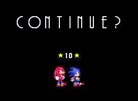
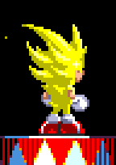

</img>
**Sonic 3 Unlocked** is an extensive modification of *Sonic the Hedgehog 3* that aims to bring modern sensibilities from the Retro Engine series of games back into the Mega Drive original.

**Amy Rose**, **Mighty the Armadillo** and **Ray the Flying Squirrel** join the playable cast, bringing with them their complete movesets from Sonic Origins and Sonic Mania.

**Encore Mode** also makes a return from Sonic Mania Plus, allowing you to play a slightly remixed version of the story.

Several **unlockable extras** have been added, with a few more planned for future releases.

Finally, **many many bugfixes and quality of life improvements** have been made, with the goal of producing the most polished version of Sonic 3 available on original hardware.

Read on for more information on the biggest changes. Enjoy!
 

# New characters
## Amy Rose
</img>
Amy excels at offense. Her **Hammer Attack** increases her attack radius without increasing her hitbox, but unlike Sonic's insta-shield, she does *not* become invincible. Watch out for fire and spikes when attacking bosses!

Hold down the jump button to charge up Amy's **Hammer Rush** ability, which not only makes short work of enemies and breakable walls, but allows her to run up steep slopes with ease.
 

## Mighty the Armadillo
</img>
Mighty is a slower, more defensive character. While rolling, his **shell** prevents him from being damaged by spikes, and with enough momentum, this even opens up some exclusive routes.

His **Hammer Drop** ability allows him to pierce straight through both enemies and breakable floors, allowing him to take a few shortcuts. The impact will also cause any nearby monitors to fall to the ground.
 

## Ray the Flying Squirrel
</img>
What he lacks in offense and defense, Ray makes up in movement. His **Air Glide** ability allows him to soar freely in the air, and with enough space around him, pick up tremendous speed.

Press the left and right buttons to alternate between gaining altitude and momentum. Release the jump button to revert back into a rolling state, perfect for taking out enemies that jump in your way.
 

# Encore Mode
</img>
Encore Mode is an extra gameplay mode accessible from the title screen. As in Sonic Mania Plus, progress for this mode is saved separately from 1 Player mode.

In Encore Mode, you play as two characters simultaneously, alternating between them at any time. Press the **A button** while both characters are on screen to **swap** which one you're currently controlling.

Swapping may be blocked, for instance, if either character's controls are locked, or if the end of the stage has been reached. In any case though, the character which is currently being controlled by player 1 will be indicated by an arrow briefly floating over their head.

When your partner character is not on screen, pressing the **A button** will instead **call** them to your position. Player 2 may also manually jump to player 1's position by pressing the **Start button** on the player 2 controller.
 

Note that due to technical limitations, characters in Encore Mode are all rendered using the same 15-color palette, so there is some slight deviation in their appearance when compared to 1 Player mode:

</img>
</img>

## Rescuing characters
</img>
Apart from characters that get rescued as part of the story, more characters can be added to your team by finding special **item boxes** or by successfully completing a **Bonus Stage**. Enter a Bonus Stage by activating a Star Post while carrying at least 35 rings. 

When a character is rescued, they will immediately join the game if nobody else is taking up the partner character slot. If there are already two characters in play, you will instead be awarded a **stock**, represented by the character's initial on the bottom left portion of the HUD.

Characters rescued as part of the story or by completing a Bonus Stage will immediately join the game and send your current partner character to the end of the **stock queue**. Item boxes will add directly to your stocks without replacing your partner character.

In Encore Mode, whenever you would normally lose a life, you will instead lose the character you were playing as. Control is then **swapped** to your partner character, a new partner is pulled from top of the stock queue, and the game continues. If swapping is blocked for whatever reason, then the game will instead restart from the last Star Post, or the beginning of the stage. Lost characters can be rescued again through normal means.
 

## Items exclusive to Encore Mode
</img>
### Roulette
Cycles through all available characters, and awards you whichever one was last displayed when the item box was destroyed. Once there are no more characters left to rescue, Roulette item boxes cycle through a set of normal items instead.
 

</img>
### Change
Sends your character to the back of the stock queue, and replaces them with the character at the top of the queue. Once there are no more characters left to rescue, the Change item can also be found in Bonus Stages.
 

</img>
### Combine Ring
Combines all of your rings into one. When you take damage, only one ring will fly out. Collect the ring before it explodes, and it will restore all of the rings you just lost.
 

# New features
</img>
**Cutscene skips:** Most cutscenes in the game can now be skipped. When the HUD is hidden from view, press the Start button to reveal a button prompt for the cutscene skip, then press the A button to confirm. Score countdowns can also be skipped by pressing the Start button.
 

</img>
**Barrier HUD:** When elemental barriers cannot be displayed, either due to a Super form or an invincibility power-up being active, they are represented by an icon on the top right corner of the screen. When you have the Combine Ring power-up, it will also appear here.

**Super button:** Super forms are now bound exclusively to the A button, so you can keep using your character's double jump moves. The barrier HUD is temporarily replaced with a button prompt for this purpose.

**Tails assist:** Double jump moves are now blocked when you hold the Up button and no other direction. This is to make it easier to be picked up by Tails, whose flight can now be controlled by player 1 as in the Marble Garden Zone 2 boss.
 

</img>
**Hidden abilities:** An extra skill is available for each character, unlocked by clearing 1 Player mode or successfully keeping the character through the end of Encore Mode. These abilities can be toggled via the Options menu, accessible by pressing the A button in the Data Select menu.

**Erase Data menu:** Individual sections of save RAM can be erased from this menu, accessible by activating the Delete option in the Data Select menu and pressing the A button. This can be used, for example, to reset Museum completion data to its initial state without affecting saved games.
 

## Museum
Coming soon...

## Other changes
</img>
Continues are no longer tracked or awarded in saved games; you can always retry after a game over. When you continue, you restart from the beginning of the current zone, as if you had reloaded the save file. Time overs will now always send you to the beginning of the act with a zeroed-out timer.

You can now jump out of a few objects you couldn't before, like the swinging wires in Sandopolis Zone or the 3-2-1 countdowns in Death Egg Zone.

Pushable objects move a lot faster, and some scripted events have been sped up slightly, such as the Sandopolis Zone 1 boss.

Various objects now have additional frames of animation to smooth out their movement. The sine/cosine look-up table has been expanded to allow for smoother orbital movement of the camera, such as while hanging from swinging vines or inside the slot machine Bonus Stage.

The stars atop a Star Post have been adjusted so that their color better matches the Bonus Stage they will take you to.

Bouncing rings now check for floor collision on every frame. This puts more strain on the hardware when there are a lot of objects on screen, but the ring object has been heavily optimized to offset some of that extra work.

A few graphics have been slightly modified to prevent them from becoming miscolored while a Super form is active, or when playing as certain characters.

</img>
The rotating drums in Carnival Night Zone have had their animation modified to communicate the effects of the player's inputs a bit better.

Super Sonic has a couple of new animations he was missing in the original Mega Drive version of the game. Tails has a new animation when he gets tired from flying. All characters have been touched up here and there to resolve various inconsistencies and oversights.

Tails and Amy's height is now proportionately reduced while rolling, rather than using the same rolling height as Sonic. Visually speaking, this is more accurate to their sprites, but it does mean that the occasional collision snag happens a little less occasionally.

Tails now receives a basic Super form upon collecting all Chaos Emeralds. The Super Tails from the original game is now Hyper Tails and has an afterimage trail like the other characters' Hyper forms.
 

## Future releases
Although there has been a *bit* of scope creep over the years, the specification for Sonic 3 Unlocked was defined at the start of development, and there are still quite a few features missing from the current version. Right now my plan is to release a total of three or so major versions as each feature is completed, but I might break them up further if there is good reason for it. We'll see.

# Cheats
The honestly obtuse S3&K cheats have been abandoned in favor of the more straightforward S3A ones. Press **Up, Up, Down, Down, Up, Up, Up, Up** at the title screen to unlock the Sound Test. The remaining cheats are then activated by playing certain sequences of songs:

- **All Chaos Emeralds:** 02, 04, 05, 06
- **All Super Emeralds:** 01, 03, 05, 07
- **Debug mode:** 01, 09, 09, 04, 01, 00, 01, 08

With debug enabled, selecting Special Stage 1 while holding down the A button will take you to the stage indicated by the Sound Test number. For convenience, pressing the left/right buttons while the A button is held will cycle the Sound Test number remotely.

Press the C button to cycle the character selection. Hold down the C button and press A to cycle backwards. In Encore Mode, the same inputs on the player 2 controller will cycle the partner character.

Hold down the C button when entering a stage to enable shadow/highlight mode. Hold down the B button to spawn at the alternate starting location for that stage, for instance, to start from Knuckles' route when playing as Sonic. Both of these cheats are only available once the debug cheat has been enabled.

In object placement mode, holding down the A button and pressing B while the item box object is selected will cycle its contents. Reminder that you can also press C while holding down A to cycle the object selection backwards.

Super monitors are now progressive. They will grant your character their Super form if they aren't already transformed, and their Hyper form if they are.

# Feedback and bug reports
If you find a bug, please file an [issue](../../issues) or tag me over on [Bluesky](https://liliambean.bsky.social). Include a screenshot or a video if possible; a savestate that reproduces the bug is even better. Feel free to report gameplay or graphical bugs of any kind, no oversight is too small! Bugs left unfixed from the original Sonic 3 are also welcome!

For collision errors though, please understand that I will only address them if they happen consistently and negatively affect gameplay, as in "whenever I do this, my character goes through the wall."

If you're unsure something is a bug, or if you have more general feedback or suggestions, please get in touch with me on Bluesky.

## A note for data miners
From its inception, Sonic 3 Unlocked has been developed in public. It is trivial to browse through the source code and find in-progress features meant for future versions. If you are curious to seek these features out, all I ask is that you do not spoil them for people who may prefer to be surprised later. Thanks.

# Does this thing use AI?
Hi, my name is Liliam. I am a trans non-binary, AuDHD, mostly self-taught programmer and pixel artist. As we are wont to be, haha.

I began work on Sonic 3 Unlocked in February 2018, over *eight years* prior to its first demo release in 2026. About two years later, I quit my IT consulting job for a much better position in a team I respected, doing modest but honest work.

In July 2026, I left that team due to a mandate that would force me to use AI in day-to-day development.

I have never touched an LLM. At this point, I am convinced they are the devil's spawn. The damage they have done to the video game reverse engineering community is **tremendous** and ***nauseating***. I am *saddened* from so many people, old and new, showing their full ass and displaying a complete lack of respect for the knowledge and skills that others have spent their entire adult lives accruing.

Sonic 3 Unlocked is something **I made** because the **process** of making things is fun.

Art is resistance. Keep creating.

## Further attribution
Amy and Mighty/Ray's sprites are taken from Sonic Origins Plus and Sonic Mania Plus respectively, color-reduced to fit the Mega Drive palette by me. Some of the poses for these characters, along with the vast majority of original graphics added to the game, were also authored by me.

The major exceptions are listed in the in-game Credits option, accessible from the title screen. The large ending sprites for Mighty and Ray were made by **Delta Conduit**, and Amy's 1-up icon and end sign were made by **E-122 Psi**, although not specifically for this project.

Additional graphics are direct references to official Sonic games, and as such are sourced directly from them. Examples include the background of the Encore mode Bonus Stage, or the shattered Super Emeralds in Hidden Palace Zone.

Several music tracks have also been imported from official Sonic games, including tracks from the November 3rd, 1993 prototype of Sonic 3. This was facilitated by the reverse engineering work on the SMPS format by **Natsumi**, **Clownacy**, and others. Sonic 3 Unlocked uses Flamedriver, a bugfixed version of the Sonic 3 sound driver by **flamewing**. A full list of credits for code reuse is available from the in-game Credits option, under 'disassembly contributors'.

Special thanks to **hiddenpalace.org** for obtaining and dumping the prototype build of Sonic 3 from which most of the extra music tracks were sourced.

Sonic Mania code was decompiled and reverse engineered in order to provide accurate implementations of Sonic's Drop Dash and Ray's Air Glide abilities. The Drop Dash was decompiled and converted to Mega Drive assembly code by **MainMemory**, and the Air Glide was decompiled by **Rubberduckycooly** and converted by me.

Any other gameplay features were eyeballed and did not reference any code from Sonic Mania, Sonic Origins or other titles. However, Sonic 3 Unlocked is quite obviously inspired by these games, as well as fan projects **Sonic 3 Complete** and **Sonic 3: Angel Island Revisited**. To all the designers, artists and developers behind these works: thank you!
