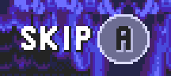

</img>
**Sonic 3 Unlocked** is an extensive modification of *Sonic the Hedgehog 3* which aims to bring over modern sensibilities from the Retro Engine titles back into the Mega Drive original.

**Amy Rose**, **Mighty the Armadillo** and **Ray the Flying Squirrel** join as playable characters, bringing with them their full movesets from Sonic Origins and Sonic Mania.

**Encore Mode** also makes a return from Sonic Mania Plus, allowing you to play a remixed version of the story.

**Many, many bugfixes and quality of life improvements** have been made, with the goal of producing the best version of Sonic 3 available on original hardware.

Finally, various **unlockable extras** are available, with many more planned in the future.

Read on if you want more information on everything that's been added. Enjoy!
 

# New characters
## Amy Rose
</img>
Amy excels at offense. Her **Hammer Attack** increases her attack radius without increasing her hitbox, but unlike Sonic's insta-shield, Amy does *not* become invincible, so watch out for fire and spikes when attacking bosses!

Hold down the jump button to charge up Amy's **Hammer Rush** ability, which not only makes short work of enemies and breakable walls, but allows her to run up steep slopes with ease.
 

## Mighty the Armadillo
</img>
Mighty is a slower, more defensive character. While rolling, his **shell** prevents him from being damaged by spikes, and with enough momentum, allows him to take certain exclusive routes.

His **Hammer Drop** ability allows him to pierce straight through both enemies and breakable floors, opening up a few shortcuts. The impact will also cause any nearby monitors to fall to the ground.
 

## Ray the Flying Squirrel
</img>
What he lacks in offense and defense, Ray makes up in movement. His **Air Glide** ability allows him to soar freely in the air, and with enough space around him, pick up tremendous speed.

Press the left and right buttons to alternate between gaining altitude and momentum. Release the jump button to revert back into a rolling state, perfect for taking out enemies that jump in your way.
 

# Encore Mode
</img>
Encore Mode can be accessed from the title screen. As in Sonic Mania Plus, progress for this mode is saved separately from 1 Player mode.

In Encore Mode, you play as two characters simultaneously, and can change between them at any time. Press the **A button** while both characters are on screen to **swap** which one you're currently controlling.

Swapping may be blocked, for instance, if either character has their controls locked, or if the end of the stage has been reached. In any case though, the character which is currently being controlled by player 1 will briefly be indicated by an arrow over their head.

When player 2 is not on screen, pressing the **A button** will instead **call** them to your position. Player 2 may also manually jump to player 1's position by pressing the **Start button** on the player 2 controller.
 

Due to technical limitations, characters in Encore Mode are all rendered using the same 15-color palette, so there is some slight deviation in their appearance when compared to 1 Player mode:

</img>
</img>

## Rescuing characters
</img>
Apart from characters who get rescued as part of the story, more characters can be added to your roster by finding special **item boxes** or completing a **Bonus Stage**. Enter a Bonus Stage by activating a star post while carrying 35 or more rings. 

When a character is rescued, they will immediately join the game if nobody else is taking up the player 2 slot. If there are already two characters in play, you will instead be awarded a **stock**, represented by the character's initial on the bottom left portion of the HUD.

Characters rescued as part of the story or by completing a Bonus Stage will immediately join the game and convert your current partner character into a stock. Item boxes will push a new character to your queue of stocks without changing your current partner.
 

## Item boxes exclusive to Encore Mode
</img>
### Roulette
Cycles through all available characters, and awards what was being displayed when the item box was destroyed. Once there are no more characters left to rescue, roulette boxes cycle through the normal set of items instead.
 

</img>
### Change
Pushes your current character to the end of the stock queue, and replaces them with the character at the top of the queue. Once there are no more characters left to rescue, this item can also be found inside of Bonus Stages.
 

</img>
### Combine Ring
Combines all of your rings into one. When you take damage, only one ring will fly out. Collect the ring before it explodes, and it will restore all of the rings you have just lost.
 

# New features
</img>
 
</img>
 
</img>
 

## Sonic 3 Unlocked
   

Sonic 3 Unlocked is a _work-in-progress_ modification of Sonic the Hedgehog 3 for the Sega Mega Drive. __No stable releases have been made available as of writing__ -- download and build at your own risk.
\
\
The final version is expected to include:
- Additional playable characters and stages
- Encore Mode (from Sonic Mania Plus)
- Unlockables and optional collectibles
- Various fixes and quality-of-life improvements

## AI Disclosure

What, are you kidding? Get out of here.
